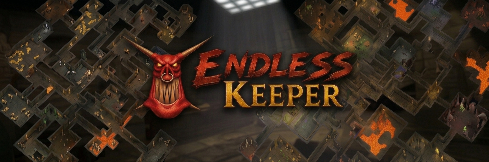

# ⛏️ Endless Keeper

### Dungeon Keeper survival sandbox mod.

*Dig forever. Grow stronger. There is always more underworld to conquer.*

---

## 📖 Introduction

**Endless Keeper** is a free, open-source mod of Bullfrog's classic **Dungeon Keeper**, built on the
[KeeperFX](https://github.com/dkfans/keeperfx) engine. Everything you love is still here: the imps, the gold, the
creatures, the slapping, the delicious evil. What changes is the world around it.

There is **no map edge**. Every run drops you into a fresh underworld generated from a seed, with biomes, gold seams,
rival keepers, hero fortresses and treasure caves as far as your imps can dig. You start small, with a few rooms and
spells. Then you explore, find research books, grow your dungeon day by day, and survive what the night brings.

### 🧱 A standalone mod, next to KeeperFX

Endless Keeper is a **standalone mod made on top of KeeperFX**. It installs into its own folder and lives **next to**
KeeperFX: it never changes, replaces or updates a KeeperFX installation, and you can keep and play both.

It is also only what its name says. KeeperFX's campaigns and its online multiplayer are the result of years of work
by the KeeperFX team, and the place to play them is KeeperFX itself. So, out of respect for that work:

- Endless Keeper's main menu has **no Campaign button**, and **Continue** takes you back to your Endless Mode world.
- Endless Keeper **does not connect to KeeperFX's multiplayer servers**, so KeeperFX's lobbies don't show up here
  and Endless Keeper players don't show up there.
- Endless Keeper has **its own launcher**, and does not use or replace KeeperFX's.

Endless Keeper adds one thing on top of KeeperFX, the endless world, and leaves the rest where it belongs. For Dungeon
Keeper's campaign, the community's campaigns or a classic multiplayer match, please get
[KeeperFX](https://keeperfx.net).

### 💭 The vision

Dungeon Keeper is one of the most loved strategy games ever made, and there is still nothing quite like it. Endless
Keeper is an attempt to bring it back to life by pairing its timeless dungeon building with the gameplay loop that
keeps players hooked in today's most popular games:

**🧭 Explore → ⛏️ Gather → 🏗️ Build → 💪 Grow stronger → 🌋 Venture further**

All of it in an endless world you can share with your friends. Picture Dungeon Keeper meets Minecraft:
every run is new, every tunnel can lead somewhere, and your dungeon keeps growing for as long as you keep it alive.

# [⬇️ DOWNLOAD HERE](https://github.com/K11MCH1/Endless-Keeper/releases)

---

> [!NOTE]
> **AI assist is involved.** 
> We do however allow mistakes. They will just be fixed! 😉

## ✨ Features

### 🌍 A world without an edge

| | Feature | What it means |
|:-:|---|---|
| ♾️ | **Endless world** | No map edge, ever. The world loads in 16×16-slab chunks around your dungeon and creatures, and freezes when nobody needs it. When you come back, it is exactly as you left it. |
| 🎲 | **Procedural generation** | Every run is a new world built from a seed: rock masses, caves, lakes, rivers, gold seams and rare gems. Nothing is sealed off: everything can be reached by digging. |
| 🏔️ | **Eight biomes** | Earthen Caverns, Rocky Depths, Volcanic Rifts, Flooded Grottos, Frozen Hollows, Sandstone Wastes and the rare Crystal Caverns and Ancient Ruins. Each has its own textures, liquids, riches and creatures. |
| 🏯 | **A keep to start in** | Every run starts in a walled keep round your Dungeon Heart, with 8 imps and 10,000 gold. The ground around it is cleared in a natural shape. |
| 🔥 | **Circles of Hell** | The land round every dungeon lies in circles. The further out a circle is, the stronger the heroes, wild packs and rival keepers you meet there. A banner greets your first dig into each circle, and the full-screen map draws the circles as faint dotted lines, with a circle's name once you have breached it. |
| 🗺️ | **Full-screen map** | The map fills the whole screen and glides over everything you have discovered: **W A S D** or drag to move (**Shift** for faster), the mouse wheel to zoom from a wide overview down to single creatures, **H** for home, **[** and **]** to jump between your battles, click to go there. |

 One seed, 49×49 chunks around the start: everything here comes from the seed alone.

### 🏰 Things to find

| | Feature | What it means |
|:-:|---|---|
| 🌀 | **Neutral portals** | Claim them to raise your creature limit (+5 each) and to unlock the creatures of their biome. |
| 💎 | **Reward caves** | Special boxes, gold hoards and wild creatures guarding research books. Increase Level and Steal Hero boxes brought to your Library fuse into one stronger box, up to +10. |
| 🛡️ | **Hero fortresses** | Moated strongholds full of heroes and books, built into the land around them: halls cross lava and water on causeways, and the moat is the biome's own. |
| ⚔️ | **Heroes outposts** | Heavily trapped hero bases hidden in the world. Break the gate, fight through the guards and destroy the Heroes Heart for XP and a spellbook. Their traps stay hidden until they go off. |
| 📐 | **Five sizes** | Fortresses and outposts are Small, Moderate, Medium, Large or Massive, matched to your strongest creature when you find them. Bigger ones hold more books, and from Medium up the heroes pour out of hero portals when you break into their rooms. |
| 👑 | **Rival keepers** | Computer keepers sleep in their dungeons until you come close. Then they wake up and fight back. Defeat them for their research books. |

### 📈 Progression

| | Feature | What it means |
|:-:|---|---|
| 📚 | **Research books** | Start with the Treasury, Lair, Hatchery, Summon Imp and Possession. Everything else is learnt from research books found in the world: each book offers up to three things to learn and you pick one. The further you travel, the better the books get. |
| 🏰 | **Amenity Mastery: rooms** | A book for a room you already have gives that room experience, more the deeper the book was found. A full bar lets the room reach its next level once your Library has researched it. The Lair, Hatchery, Library, Training Room, Treasury, Workshop, Prison, Torture Chamber, Barracks and Graveyard all have levels, each with its own reward. |
| ✨ | **Amenity Mastery: spells and traps** | The same goes for Create Imp, Sight of Evil, Speed Monster, Conceal Monster, Heal, Lightning Strike and Protect Monster, and for the Poison Gas, Lightning, Word of Power and Lava traps, whose levels the Workshop builds. Room and spell icons show their level and a small bar for the next one. What each level gives is for you to find out. |
| 🧪 | **Levels up to 100** | Creatures and heroes can grow all the way to level 100, learning new abilities along the way. |
| ⛏️ | **Imps learn by mining** | Every turn spent mining gold makes your imps a little more experienced. |
| 🏅 | **Player levels** | Every Dungeon Heart you destroy (keeper or heroes) earns you XP and player levels. |
| 📜 | **Misdeeds** | Every creature keeps a record of what it has done, shown on the Rap Sheet, a new tab of the creature panel. High-level creatures earn vices picked from what they did most, and can be renamed once. |
| 🩸 | **Veterans matter** | A veteran speeds up the training of newcomers of its kind. When one falls, your imps can carry its body home to the Graveyard, and a veteran lost for good passes a vice on to the next creature of its kind. |

### 🌗 Day and night

| | Feature | What it means |
|:-:|---|---|
| ☀️ | **Day** | 12 minutes. Hero raiding parties may break in through the ceiling and dig towards your heart. How many parties land, and who is in them, follows your strongest creature: Thieves and Tunnellers at first, later Knights, Wizards, Giants and the other heroes of the biome they land in. |
| 📖 | **Raiders carry books** | The first raid of every day always comes, and it brings a research book with it. Kill the hero who carries it and it is yours. |
| 🏃 | **Raids end** | Raiders who haven't been dealt with walk home at the next dawn, a party whose leader falls leaves at once, and raids leave you breathing room between them. |
| 🌙 | **Night** | 8 minutes. Packs of wild creatures (spiders, skeletons, beetles, flies, zombies and worse) crawl out of the dirt paths and water. At dawn they fade away. |
| 🕳️ | **Burrows** | From the second night, packs also break out of burrows in the earth near your dungeon, and their Beetles dig a tunnel towards it. Empty burrows and tunnels fall in again at dawn. Wild creatures drop gold when they die. |
| 🕰️ | **Sun and moon dial** | An animated dial shows the time of day at a glance. |
| 💾 | **Autosave** | Your run is saved at every dawn and when you quit. |

### 🌐 Multiplayer

| | Feature | What it means |
|:-:|---|---|
| 🏠 | **Shared worlds** | Host a world and let friends join at any time, even while it is running. Each player gets their own start in the same world, 1,000 to 2,000 slabs from the nearest other player. |
| 📋 | **World List** | Browse the running worlds of every Endless Keeper server with their players and ping, chat with everyone in the menu, or type a server's address to see its worlds. |
| 🤝 | **Co-op parties** | Invite a player to your party in the World List and enter a world together. You start side by side as allied keepers: you see everything your ally sees and can drop creatures on their ground. Enemies that come for a party are one level higher. |
| 🏘️ | **Solo and co-op dungeons** | Every player has a solo dungeon and a co-op dungeon. Entering a world alone takes you to your solo dungeon; entering with your party takes you to the pair of co-op dungeons you share, far out beyond the solo ones. |
| 🚪 | **Come back any time** | A player who leaves keeps their dungeon in the world and gets it back when they return. While you are away a caretaker keeps your solo dungeon: it puts creatures to work, places the traps your Workshop made and defends, but builds, digs and attacks nothing. A co-op dungeon freezes instead. |
| 💬 | **Chat box** | In a shared world, chat sits in a box at the bottom of the screen that you can scroll, shrink to just the lines, or close. |
| 🛡️ | **Roles and commands** | A server can give players roles with a name colour and permissions for commands typed in the game, such as `!mute` or `!kick`. `/help` lists yours. `!delete dungeon` permanently deletes the dungeon you are playing so you can start a new one. |
| 🚀 | **Built for many players** | The server runs the world and streams it to the players, so there are no desyncs and a lagging player never holds anyone up. Designed for up to 100 players in one world, with a 64-bit version for busy servers. |

> [!NOTE]
> **Multiplayer servers are not publicly available yet. They are coming soon!** Until then you can host a world
> yourself and let friends join by address.

---

## 🗺️ Roadmap

Three systems from the roadmap arrived with release 8 and keep growing. Their pages tell where each is heading:

- **[Misdeeds](roadmap/MISDEEDS.md)**: creatures remember what they did, earn vices for it, and can be named.
  Still to come: longer names.
- **[Circles of Hell](roadmap/CIRCLES-OF-HELL.md)**: the land around every dungeon is cut into named circles, each
  with stronger residents and better loot than the last. Still to come: rival keepers that grow while left alone.
- **[Amenity Mastery](roadmap/AMENITY-MASTERY.md)**: rooms, spells and traps are mastered over time with experience
  from duplicate books, worth more the deeper they were found. Still to come: levels shown on trap icons.

  There is more! Just not polished and outlined here.

---

## 🖥️ Requirements

| | Requirement |
|:-:|---|
| 💻 | **Windows 10 or 11**. 64-bit is recommended: big worlds can use up to 4 GB of memory. |
| 💿 | **An original copy of Dungeon Keeper** (GOG, Steam or the original CD). Endless Keeper does not include the original game: its art, sound and music come from your copy. Only the Zombie brings its own sprites and voice, with a few parts adapted from the original. |
| 🔥 | **KeeperFX 1.4.0 (stable).** Endless Keeper is built on it. The setup downloads it for you (about 360 MB) from KeeperFX's own GitHub releases, so you need an internet connection during setup. |
| 🌐 | **For hosting over the internet:** port 5556 open (UDP) on your router or firewall. |

---

## 🎮 How to play

1. **Download** the newest `EndlessKeeperSetup-….exe` from the [Releases](https://github.com/K11MCH1/Endless-Keeper/releases)
   page, for example `EndlessKeeperSetup-1_4_0-1-Alpha.exe`: Endless Keeper release **1**, built on KeeperFX
   **1.4.0**, in **Alpha**.
2. **Run it.** Endless Keeper gets its own folder (`C:\Games\EndlessKeeper` unless you pick another), so an existing
   KeeperFX installation stays exactly as it is.
3. **Show it your Dungeon Keeper.** The setup finds GOG, Steam, EA/Origin and KeeperFX installations by itself, or
   you can choose the folder. It copies the few original files the game needs (palettes, two texture files, three
   sound banks and, for digital copies, the music).
4. **Wait a minute** while it downloads the KeeperFX base game and installs Endless Keeper on top of it.
5. **Start Endless Keeper** from the Start menu (or the desktop). Its launcher opens: press **Play**, then choose
   **Endless Mode** in the main menu. The launcher's **Settings** hold the game's options.

> [!TIP]
> **Updating:** the launcher tells you when a new release is out and installs it with one click; your saves and
> settings stay. You can also run the newer setup and keep the same folder. **Uninstalling** removes everything
> except your saved games.

Installing by hand instead

1. Unpack KeeperFX's [`keeperfx_1_4_0_complete.7z`](https://github.com/dkfans/keeperfx/releases/tag/v1.4.0) into
   an empty folder.
2. Unpack `endless-keeper-…-patch.7z` (or the `.zip`) from the [Releases](https://github.com/K11MCH1/Endless-Keeper/releases)
   page over it, replacing files. The patch is only for a folder of Endless Keeper's own: never unpack it into your
   KeeperFX installation.
3. Copy `data\bluepal.dat`, `bluepall.dat`, `dogpal.pal`, `hitpall.dat`, `lightng.pal`, `redpal.col`, `redpall.dat`,
   `slab0-0.dat`, `slab0-1.dat`, `vampal.pal`, `whitepal.col` and `sound\atmos1.sbk`, `atmos2.sbk`, `bullfrog.sbk`
   from your Dungeon Keeper (or KeeperFX) folder into the same places, and the music (`keeper02.ogg` to
   `keeper07.ogg`) into `music\` if you have it.
4. Delete `keeperfx-launcher-qt.exe` and `keeperfx-launcher-legacy.exe`: KeeperFX's launcher would update the folder
   to plain KeeperFX.
5. Start `EndlessKeeper.exe`, Endless Keeper's launcher.

> [!NOTE]
> Endless Keeper follows KeeperFX's stable releases with its own releases.

---

## 🛠️ How this project was made

Endless Keeper is not a rewrite. It extends the open-source **KeeperFX** engine (C and C++), so the original
gameplay stays exactly as Dungeon Keeper players know it, and the new systems are built around it:

- 🧩 **Chunked world streaming.** The world is split into chunks that load around activity and freeze when they are
  not needed. Frozen chunks keep their slabs, rooms, creatures, objects, traps and dig orders, and everything is
  stored in the save file.
- 🌱 **A seeded world generator.** The same seed always builds the same world, on every computer. It places
  biomes, liquids, gold, portals, caves, fortresses, outposts and rival keepers.
- 📡 **Server-run multiplayer.** Instead of the classic lockstep model, the server simulates the world and streams
  a compressed state to each player, sending each one only what they need.
- 📏 **Bigger limits.** Room for 104 players, worlds that can use 4 GB of memory, and creatures up to level 100.
- 🔒 **Safer Lua.** Compiled Lua code is refused when it comes from saves, replays or other computers.
- ✅ **Tested against the classic game.** Recorded replays of original campaign levels are played back after every
  change to make sure the original game still plays the same.

### 🧱 Stability

| | What was done | What it means |
|:-:|---|---|
| 🔁 | **No desyncs by design** | Only the server simulates. Players receive the result, so a slow or frozen player never stalls the others and nobody drifts out of step. |
| 🧪 | **Every speed-up is checked against the old code** | Each optimisation that must not change the game was run both ways side by side and compared: hundreds of thousands of comparisons, no differences. The optimised build was shown to reach the same game state as the plain one, on 32-bit and 64-bit. |
| 🔍 | **Code audits** | The whole codebase was audited several times for bugs and slow spots, and the findings fixed release by release. |
| 💾 | **Careful saves** | Saves carry a version and are converted when the format grows, so older saves keep loading. A save or load that fails does so cleanly, and the world is saved at every dawn. |
| 🔑 | **Sealed logins** | A player's seat belongs to a secret token, not a nickname, and the login is encrypted for each world. |
| 📶 | **Bad connections** | Each turn is also sent as a second, unordered copy. With 2% packet loss, visible stalls fell from about 13 to about 1 every 20 seconds. |
| 🖥️ | **Graphics cards that refuse big textures** | The game tries smaller sprite sheets, then a fallback, instead of drawing nothing. |
| 🚪 | **Doors, traps and lairs at chunk edges** | Frozen chunks keep hidden traps hidden, lairs in place and doors standing when their neighbour freezes first. |

### 📦 Efficiency

| | What was done | What it means |
|:-:|---|---|
| 🎯 | **Each player gets only their part of the world** | Their own creatures, what is near them and what is in their hand. Creature details of the whole world are no longer sent to everyone. |
| 🗜️ | **Smaller network traffic** | From 13.7 KB to 2.3 KB a turn for a real player (about 46 KB a second), with Zstandard compression and dictionaries trained on real play. |
| 🧠 | **Less memory** | A thing in the world takes 196 bytes, down from 2,244. The server keeps a sparse copy for each player in place of a full 27.6 MB one. |
| 🗄️ | **Faster compression and checksums** | libdeflate and XXH3 replace the slower stock routines where the world is streamed and saved. |
| 🏗️ | **64-bit build** | A 64-bit game ships beside the 32-bit one for busy servers and big worlds. 32-bit and 64-bit players can share a world and its saves. |

### 🚀 Performance

| | What was done | What it means |
|:-:|---|---|
| 💯 | **100 busy dungeons at full speed** | A dedicated server runs 100 active keepers in one world without slowing the game down. |
| 🧵 | **The stream runs on all processor cores** | Comparing and compressing the world for the players went from 16.2 ms to 5.7 ms a turn. |
| 🔦 | **Searches look nearby first** | Creatures looking for enemies no longer scan the whole world. With 100 keepers a turn went from 40.8 ms to 26.8 ms, and the worst turn from 95 ms to 56 ms. |
| ⏱️ | **Chunk work on a budget** | Loading and freezing chunks is queued and spread over turns, so exploring does not cause hitches. |
| ⚙️ | **Link-time optimisation** | The whole game is optimised as one program: about a quarter less time per turn. |
| 🌍 | **Faster world generation** | The generator remembers ground it has already worked out, with exactly the same result for every seed. |
| 🔬 | **Measured, not guessed** | The engine is profiled with Tracy, and each round of speed-ups starts from what the profile shows. |

👉 Want to build it yourself or dig into the code? Read the **[Development Guide](docs/DEVELOPMENT.md)** for
setting up a development environment and building KeeperFX from source.

---

## 🤝 Contributing

**Everyone is welcome to help make Endless Keeper better!** Whether you code, test, design levels or just love
Dungeon Keeper, there is a place for you.

| | How to help |
|:-:|---|
| 🐞 | **Found a bug?** Report it in the [Issues](https://github.com/K11MCH1/Endless-Keeper/issues) tab. Tell us what happened, what you expected, and attach your `keeperfx.log` if you can. |
| 💡 | **Have an idea?** Submit a feature request in the [Issues](https://github.com/K11MCH1/Endless-Keeper/issues) tab. |
| 💬 | **Want to discuss improvements or work on something bigger?** Get in touch with **KIMCHI** on the [Keeper Klan Discord](https://discord.com/invite/hE4p7vy2Hb) first. |
| 🔧 | **Ready to code?** Start with the [Development Guide](docs/DEVELOPMENT.md), then open a pull request. |

---

## 🙏 Credits

| | |
|---|---|
| 🎮 **Bullfrog Productions** | For creating *Dungeon Keeper* (1997), published by Electronic Arts. |
| 🔥 **The KeeperFX team and contributors** | For [KeeperFX](https://github.com/dkfans/keeperfx), the open-source engine Endless Keeper is built on. None of this would exist without their years of work. |
| 🔒 **Flip-FriendSpace** | For the Lua security fix, ported from [keeperfx-dx12](https://github.com/Flip-FriendSpace/keeperfx-dx12). |
| 📦 **Open-source libraries** | SDL, SDL_mixer and SDL_image, LuaJIT, ENet, zlib, libspng, FFmpeg, OpenAL Soft, libcurl, miniupnpc, libnatpmp and the other libraries KeeperFX builds on; Dear ImGui and stb_image in the launcher. |

---

## 📜 License

Endless Keeper is free software, released under the **[GNU General Public License v2.0](LICENSE)**, the same
license as KeeperFX.

*Dungeon Keeper* and its art, sounds and music are the property of Electronic Arts. They are **not** part of this
project: you need your own copy of the original game to play.
