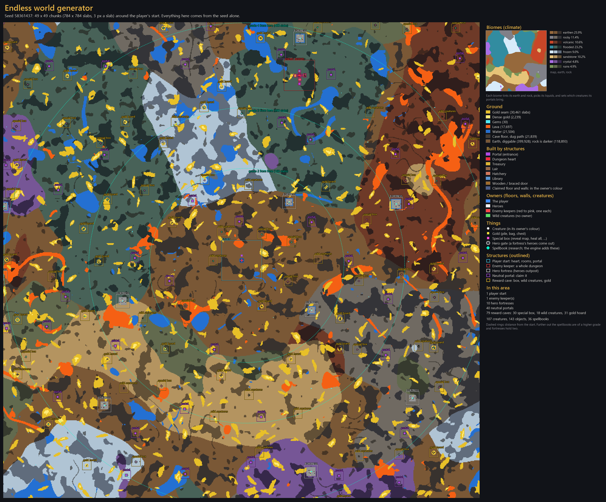
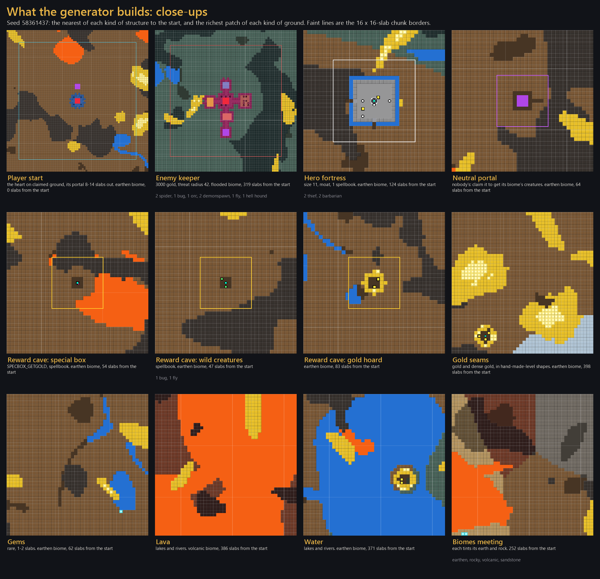

# ⛏️ Endless Keeper

### Dungeon Keeper, reborn as an endless, living underworld.

*Dig forever. Grow stronger. There is always more underworld to conquer.*

---

## 📖 Introduction

**Endless Keeper** is a free, open-source mod of Bullfrog's classic **Dungeon Keeper**, built on the
[KeeperFX](https://github.com/dkfans/keeperfx) engine. Everything you love is still here: the imps, the gold, the
creatures, the slapping, the delicious evil. What changes is the world around it.

There is **no map edge**. Every run drops you into a fresh underworld generated from a seed, with biomes, gold seams,
rival keepers, hero fortresses and treasure caves as far as your imps can dig. You start small, with a few rooms and
spells. Then you explore, find research books, grow your dungeon day by day, and survive what the night brings.

### 💭 The vision

Dungeon Keeper is one of the most loved strategy games ever made, and there is still nothing quite like it. Endless
Keeper is an attempt to bring it back to life by pairing its timeless dungeon building with the gameplay loop that
keeps players hooked in today's most popular games:

**🧭 Explore → ⛏️ Gather → 🏗️ Build → 💪 Grow stronger → 🌋 Venture further**

All of it in an endless world you can share with your friends. Picture Dungeon Keeper meets Minecraft:
every run is new, every tunnel can lead somewhere, and your dungeon keeps growing for as long as you keep it alive.

---

## ✨ Features

> [!NOTE]
> **Multiplayer servers are not publicly available yet. They are coming soon!** Until then you can host a world
> yourself and let friends join by address.

### 🌍 A world without an edge

| | Feature | What it means |
|:-:|---|---|
| ♾️ | **Endless world** | No map edge, ever. The world loads in 16×16-slab chunks around your dungeon and creatures, and freezes when nobody needs it. When you come back, it is exactly as you left it. |
| 🎲 | **Procedural generation** | Every run is a new world built from a seed: rock masses, caves, lakes, rivers, gold seams and rare gems. Nothing is sealed off: everything can be reached by digging. |
| 🏔️ | **Eight biomes** | Earthen Caverns, Rocky Depths, Volcanic Rifts, Flooded Grottos, Frozen Hollows, Sandstone Wastes and the rare Crystal Caverns and Ancient Ruins. Each has its own textures, liquids, riches and creatures. |
| 🗺️ | **Endless map** | The full-screen map scrolls over everything you have discovered (**W A S D**, **Shift** for faster, **H** for home, click to go there). |

 One seed, 49×49 chunks around the start: everything here comes from the seed alone.

### 🏰 Things to find

| | Feature | What it means |
|:-:|---|---|
| 🌀 | **Neutral portals** | Claim them to raise your creature limit (+5 each) and to unlock the creatures of their biome. |
| 💎 | **Reward caves** | Special boxes, gold hoards and wild creatures guarding research books. |
| 🛡️ | **Hero fortresses** | Moated strongholds full of heroes and spellbooks. |
| ⚔️ | **Heroes outposts** | Large, heavily trapped hero bases hidden in the world. Break the gate, fight through the guards and destroy the Heroes Heart for XP and a spellbook. |
| 👑 | **Rival keepers** | Computer keepers sleep in their dungeons until you come close. Then they wake up and fight back. Defeat them for their research books. |

### 📈 Progression

| | Feature | What it means |
|:-:|---|---|
| 📚 | **Research books** | Start with the Treasury, Lair, Hatchery, Summon Imp and Possession. Everything else is learnt from research books found in the world, and the further you travel, the better they get. |
| 🧪 | **Levels up to 100** | Creatures and heroes can grow all the way to level 100, learning new abilities along the way. |
| ⛏️ | **Imps learn by mining** | Every turn spent mining gold makes your imps a little more experienced. |
| 🏅 | **Player levels** | Every Dungeon Heart you destroy (keeper or heroes) earns you XP and player levels. |

### 🌗 Day and night

| | Feature | What it means |
|:-:|---|---|
| ☀️ | **Day** | 12 minutes. Hero raiding parties, led by a Tunneller, may break in through the ceiling and dig towards your heart. The longer you survive, the tougher they get. |
| 🌙 | **Night** | 8 minutes. Packs of wild creatures (spiders, skeletons, beetles, flies and worse) crawl out of the dirt paths and water. At dawn they fade away. |
| 🕰️ | **Sun and moon dial** | An animated dial shows the time of day at a glance. |
| 💾 | **Autosave** | Your run is saved at every dawn and when you quit. |

### 🌐 Multiplayer

| | Feature | What it means |
|:-:|---|---|
| 🏠 | **Shared worlds** | Host a world and let friends join at any time, even while it is running. Each player gets their own start somewhere in the same world. |
| 📋 | **World List** | Browse running worlds with their players and ping, chat with everyone in the menu, or join by address. |
| 🚀 | **Built for many players** | The server runs the world and streams it to the players, so there are no desyncs and a lagging player never holds anyone up. Designed for up to 100 players in one world. |
| 🚪 | **Come back any time** | A player who leaves keeps their dungeon in the world and gets it back when they return. |

### ⚖️ Rule changes for an endless game

- 🪨 **Cave-In** and ⚡ **Lightning Strike** can only be cast on your own claimed ground.
- 🧱 **Destroy Walls** and ☄️ **Armageddon** are switched off.
- 💀 You lose only when your own Dungeon Heart is destroyed. There is no "win": the world simply goes on.

---

## 🗺️ Roadmap

**TBA.** Stay tuned on the [Keeper Klan Discord](https://discord.com/invite/hE4p7vy2Hb)!

---

## 🖥️ Requirements

| | Requirement |
|:-:|---|
| 💻 | **Windows 10 or 11**. 64-bit is recommended: big worlds can use up to 4 GB of memory. |
| 💿 | **An original copy of Dungeon Keeper** (GOG, Steam or the original CD). Endless Keeper contains none of the original game's art, sound or music. |
| 🔥 | **KeeperFX 1.4.0 Alpha (build 5593)**, installed with your Dungeon Keeper files. Endless Keeper is built on this version and uses its game data. |
| 🌐 | **For hosting over the internet:** port 5556 open (UDP) on your router or firewall. |

---

## 🎮 How to play

1. **Install KeeperFX.** Get it from [keeperfx.net](https://keeperfx.net), point it at your Dungeon Keeper files and
   start it once to check that it runs.
2. **Get Endless Keeper.** Ready-to-play downloads are coming soon. For now, build it from source with the
   [Development Guide](docs/DEVELOPMENT.md) (it takes a few minutes).
3. **Copy the files** into your KeeperFX folder. Keep a backup of your original `keeperfx.exe` first!

   | From this project | To your KeeperFX folder |
   |---|---|
   | `out/keeperfx.exe` (your build) | `keeperfx.exe` |
   | `levels/endless.cfg`, `levels/endless/`, `levels/endless_cfgs/` | `levels/` |
   | `config/fxdata/lua/` | `fxdata/lua/` |

4. **Start `keeperfx.exe`** and choose **Endless Mode** in the main menu (it takes the place of Free Play Levels).

| Endless Mode menu | |
|---|---|
| ▶️ **Continue** | Load your newest endless save. |
| ✨ **New Run** | Start a brand new world with a random seed. |
| 📂 **Load Game** | Pick one of your endless saves. |
| 🏠 **Host Network Game** | Start a new world that others can join. |
| 🤝 **Join Network Game** | Open the World List, or join a world by its address. |

**🧙 Tips for your first run**

- Your start has no gold close by: send your imps to the two gold seams just beyond it.
- Claim the nearby portal early. More portals mean more and different creatures.
- Click research books on your own ground with the Hand. The first one gives you a Library.
- Build your defences before the first night, and keep an eye on the dial in the top right corner.

> [!WARNING]
> The KeeperFX launcher replaces `keeperfx.exe` when it updates the game. If that happens, copy the Endless Keeper
> files again (or skip the update).

---

## 🛠️ How this project was made

Endless Keeper is not a rewrite. It extends the open-source **KeeperFX** engine (C and C++), so the original
gameplay stays exactly as Dungeon Keeper players know it, and the new systems are built around it:

- 🧩 **Chunked world streaming.** The world is split into chunks that load around activity and freeze when they are
  not needed. Frozen chunks keep their slabs, rooms, creatures, objects, traps and dig orders, and everything is
  stored in the save file.
- 🌱 **A seeded world generator.** The same seed always builds the same world, on every computer. It places
  biomes, liquids, gold, portals, caves, fortresses, outposts and rival keepers.
- 📡 **Server-run multiplayer.** Instead of the classic lockstep model, the server simulates the world and streams
  a compressed state to each player, sending each one only what they need.
- 📏 **Bigger limits.** Room for 104 players, worlds that can use 4 GB of memory, and creatures up to level 100.
- 🔒 **Safer Lua.** Compiled Lua code is refused when it comes from saves, replays or other computers.
- ✅ **Tested against the classic game.** Recorded replays of original campaign levels are played back after every
  change to make sure the original game still plays the same.

👉 Want to build it yourself or dig into the code? Read the **[Development Guide](docs/DEVELOPMENT.md)** for
setting up a development environment and building KeeperFX from source.

---

## 🤝 Contributing

**Everyone is welcome to help make Endless Keeper better!** Whether you code, test, design levels or just love
Dungeon Keeper, there is a place for you.

| | How to help |
|:-:|---|
| 🐞 | **Found a bug?** Report it in the [Issues](https://github.com/K11MCH1/Endless-Keeper/issues) tab. Tell us what happened, what you expected, and attach your `keeperfx.log` if you can. |
| 💡 | **Have an idea?** Submit a feature request in the [Issues](https://github.com/K11MCH1/Endless-Keeper/issues) tab. |
| 💬 | **Want to discuss improvements or work on something bigger?** Get in touch with **KIMCHI** on the [Keeper Klan Discord](https://discord.com/invite/hE4p7vy2Hb) first. |
| 🔧 | **Ready to code?** Start with the [Development Guide](docs/DEVELOPMENT.md), then open a pull request. |

---

## 🙏 Credits

| | |
|---|---|
| 🎮 **Bullfrog Productions** | For creating *Dungeon Keeper* (1997), published by Electronic Arts. |
| 🔥 **The KeeperFX team and contributors** | For [KeeperFX](https://github.com/dkfans/keeperfx), the open-source engine Endless Keeper is built on. None of this would exist without their years of work. |
| 🔒 **Flip-FriendSpace** | For the Lua security fix, ported from [keeperfx-dx12](https://github.com/Flip-FriendSpace/keeperfx-dx12). |
| 📦 **Open-source libraries** | SDL, SDL_mixer and SDL_image, LuaJIT, ENet, zlib, libspng, FFmpeg, OpenAL Soft, libcurl, miniupnpc, libnatpmp and the other libraries KeeperFX builds on. |

---

## 📜 License

Endless Keeper is free software, released under the **[GNU General Public License v2.0](LICENSE)**, the same
license as KeeperFX.

*Dungeon Keeper* and its art, sounds and music are the property of Electronic Arts. They are **not** part of this
project: you need your own copy of the original game to play.
