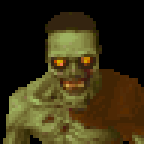

# New Creatures

New creatures and new heroes are coming to Endless Keeper, each with its own sprites, sounds and mechanics, made to
fit the look of the original game. They arrive one at a time, and each one gets its own section on this page.

## Introduced so far

| | Creature | Arrived in |
|---|---|---|
|  | [Zombie](#zombie) | Release 8 |

## Zombie

A slow, tough brawler that hunts by smell and fights best in a crowd of its own kind.

### Where it comes from

- Zombies roam every biome in **wild packs** of four to six, most often in the Frozen Hollows and the Ancient Ruins.
- No portal brings one, and no room draws one. To own Zombies, capture them in your Prison and convert them in the
  Torture Chamber.

### Its lair

A Zombie's lair is a **gravestone**. It squats, digs itself into the mound and sinks out of sight to sleep, and the
mound breathes slowly while it rests. To wake, one arm bursts up out of the earth and the body pulls itself out after
it, twice as fast when enemies come near.

### What it is like

- **Tough and slow**: 650 health and good armour, but it walks about a third slower than a Demon Spawn.
- **Smells the enemy**: it scents enemies from far off and walks to them on its own.
- **Pack fighter**: it hits 2% harder for each other Zombie of yours standing right beside it, up to 20%.
- **Flammable**: fire shots and lava hurt it 15% more.
- **Slow to heal**: healing spells work only half as well on it.
- **Fearless**: it can't be frightened, and Poison Gas does nothing to it.
- **Possessed**, it sees the world blurred and tinted rot-yellow.
- It fights and guards. It won't research, build in the Workshop or pray at the Temple.

### Abilities

| Level | Ability | What it does |
|---|---|---|
| 1 | Fists | A plain melee attack. |
| 2 | Armour | The usual armour spell on itself. |
| 4 | Slowing Bite | A bite that slows its victim. |
| 7 | Draining Bite | A bite that drains the victim's life into the Zombie. |
| 10 | Frenzy | For ten seconds, 20% more damage and attacks half again as fast, with red sparks round it. Ready from the start, then once every three minutes. |
